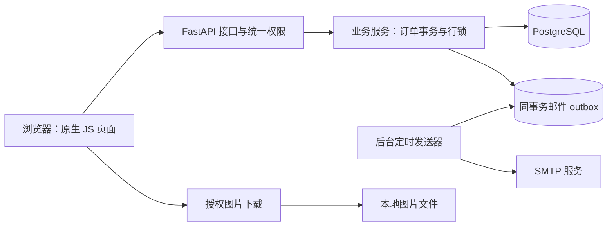

# 阶段六：审查问题修复与架构评估

日期：2026-10-29。基线：`b5d87ca`。修复分支：`codex/review-hardening`。界面版本：1.8.0。

## 结论

继续采用 FastAPI + SQLAlchemy + PostgreSQL + 原生 JavaScript 的模块化单体。此次问题主要来自事务并发、权限过滤、查询方式和发布流程，没有证据表明需要重写前端或引入微服务。通过局部改造已经消除主要查询放大，并把邮件发送移出业务事务。

代码在本地独立分支完成；生产部署、实际 Nginx 配置和真实并发容量需在上线环节验证。本文不把本地合成数据的延迟当作生产 P95 或吞吐量。

## 已完成的修复

| 问题 | 改动 | 验证 |
| --- | --- | --- |
| 审批竞争导致订单卡在部分通过 | 借用单父行先加锁，再刷新任务；审批、驳回、取消遵循同一顺序 | 双人通过、通过与驳回竞争、审批与取消竞争、同一任务重复审批 |
| 列表、详情、时间线权限不一致 | 统一订单访问范围，同时覆盖旧借用/归还列表及审计查询 | 无关管理员不可读取订单；只可读取自己的非订单操作日志 |
| 私有附件可直接访问 | 元数据检查所属订单；下载检查权限；工作流图片使用 15 分钟、绑定路径与用户的签名链接 | 未登录、无关管理员、篡改签名被拒绝；合法签名可读 |
| 全量订单加载后才分页 | 数据库筛选/计数/分页；当前页批量预加载关联 | 状态回归、1000 条合成订单查询预算 |
| 审批 N+1 查询 | 批量读取当前页订单、明细和照片 | 20 条借出任务 5 次 SQL，归还任务 6 次 SQL，均含鉴权 |
| 统计失败显示 0 | 明确显示暂不可用；保留成功缓存时注明时间并提供重试 | 失败、缓存失效、换用户、请求取消后重试 |
| 轮询放大请求 | 单个 summary 接口；25 秒前端缓存；30 秒轮询；隐藏页面停止定时器 | 请求合并、后台页面不轮询 |
| 拼音回车与建议不一致 | 持久化全拼/首字母，统一匹配规则；名称变更同步更新；建议点击按 ID 打开详情 | 接口查询、名称更新、浏览器 `guangpu` 回车 |
| 旧页面请求阻塞新导航 | 新导航取消旧 GET 请求，保持路由执行顺序防止过期页面覆盖；写操作不被取消 | 慢页面切换、旧响应与提交请求隔离 |
| 短暂网络故障清除登录 | 仅明确 401 清理会话；无缓存身份时提供重新连接 | 启动 500 保留会话 |
| 图片处理占用事件循环 | 同步端点在 FastAPI 线程池执行；按上限读取；前端最多同时上传 2 张 | 超限不解码；图片处理等待期间，统计请求仍能完成 |
| 邮件先于业务提交发送 | 同事务写入 outbox；后台领取并发送；失败退避重试 | 未提交不可发送、回滚不留下邮件、多 worker 不重复领取、失败可重试 |
| 漏迁移上线 | 应用与迁移统一配置源；启动检查版本及关键字段；新增数据库就绪接口 | 从线上旧版本升级回放、拼音回填、就绪状态 503 → 200 |
| 静态资源无法有效缓存 | 启动时生成内容哈希 URL，资源快照 immutable，HTML ETag 再验证，GZip | HTML 304、资源缓存头、错误哈希 404 |
| 审批列表与手机导航不便 | 桌面紧凑行、明确详情按钮；手机固定主入口与更多菜单；过期申请提示 | 桌面与 390px 手机浏览器检查 |
| 可访问性不足 | 搜索 combobox/listbox、键盘选项状态；图片关闭按钮、Esc、焦点回收 | 组件回归与浏览器检查；未进行完整读屏认证 |

库存展示图片继续采用公开目录图片的既有策略；借还留痕图片受保护。临时附件及元数据不再通过静态目录暴露。签名图片链接过期后刷新页面即可重新获取。

## 性能依据

修复前审查探针：1000 张订单返回 20 条，执行 2003 次 SQL，本地约 1.4–2.5 秒。修复后的查询预算用例：10 张和 1000 张订单均执行 4 次 SQL，本轮约 17–18 毫秒；本轮使用专门的合成回归夹具，不能当作生产容量测试或严格同负载 A/B。

借出审批当前页含 20 条真实明细时为 5 次 SQL（含鉴权），归还审批为 6 次。summary 为 2 次（含鉴权）。分页 SQL 次数不再随历史订单数量线性增长。

前台稳定轮询从最多约 36 个请求/分钟降为约 2 个 summary 请求/分钟；页面操作、主动刷新和搜索索引请求另计。页面隐藏时停止轮询。库存或流程变化后的内容刷新仍使用既有路由渲染，后续可以按实际需要改为局部更新。

## 架构是否升级



| 层 | 当前决策 | 何时再升级 |
| --- | --- | --- |
| 后端服务 | 保留单体，集中权限和事务边界，接口只做编排 | 团队出现独立服务所有权、独立发布需求后再评估拆分；借还核心状态应保持一个事务边界 |
| 数据库 | 保留 PostgreSQL；先看执行计划、索引与连接池等待 | 真实数据量增长后，用 EXPLAIN ANALYZE 决定组合索引、pg_trgm 或游标分页；不能仅因数据达到某个数字就分库 |
| 前端 | 保留现有框架；已解决缓存、请求取消和导航问题 | 全局状态/页面复用明显拖慢开发时，逐页迁移 ES modules、类型检查和组件；通过同一套回归测试逐步替换 |
| 邮件与后台任务 | 当前复用 APScheduler + 数据库队列，避免新增 Redis 运维成本 | 积压或任务耗时影响 Web 进程时，先把同一 outbox worker 独立为 systemd 服务，再评估专用队列 |
| 上传与存储 | 线程池和并发上限适合当前规模 | 图片工作量持续挤占 Web 线程池时独立图像 worker；多实例共享文件或容量压力出现时采用对象存储与授权下载 |
| 可观测性 | request_id、Server-Timing、结构化请求日志、DB readiness、查询预算 | 持续收集真实 P95、错误率、DB 池等待、上传耗时和 outbox 积压，再决定扩容 |

建议先在真实使用高峰采集一周基线，设置服务目标，例如列表 P95 < 500ms、审批 API P95 < 1s，再以观测结果调整。这些是建议目标，不是已验证的生产 SLA。

outbox 使用租约与 SKIP LOCKED，可支持多个发送器并发领取；每封邮件最多尝试 6 次，退避上限 1 小时，耗尽后保留记录并记录错误。SMTP 不支持事务，因此“已发送但进程尚未标记成功就退出”仍可能造成重复投递，这是至少一次投递的边界。失败记录可用只读 SQL 排查：

```sql
SELECT id, attempts, next_attempt_at, locked_until, last_error
FROM email_outbox WHERE sent_at IS NULL ORDER BY next_attempt_at;
```

当前每天的照片清理仍沿用原有调度方式；增加多个 Web worker 前应把维护类任务集中到一个调度进程。此次没有增加 worker 数量。

## 测试与 Git 管理

- 基线 `b5d87ca` 保持在 main；功能在 `codex/review-hardening` 分支按职责提交。
- 不强推、不重写历史，不把环境文件、真实账号、上传图片或临时数据库加入版本控制。
- 测试使用随机命名的临时数据库，结束后销毁；图片使用临时目录。原业务数据库未迁移、未清空。
- 后端全量回归 101 通过、2 项需显式开启的 live E2E 跳过；随后新增的 3 项上传/错误响应测试也全部通过，合计 104 个唯一测试通过。
- 前端 Node 回归 12 项通过。新增 CI 使用 PostgreSQL 16 与 Python 3.12，尚未在远端触发。
- 浏览器检查覆盖首次登录工作台、桌面审批、详情/过期提示、手机导航/更多菜单、拼音回车。使用合成账号和器材，没有对生产订单执行写入操作。
- 依赖仍有原有 Pydantic、python-jose/passlib 弃用或兼容提示，另行进行依赖维护；本次没有做整体依赖替换。

在仓库根目录复现：

```powershell
.\backend\.venv\Scripts\python.exe backend/scripts/test_isolated.py -q
node --test frontend/tests/*.test.cjs
```

Linux 使用对应虚拟环境 Python 执行相同脚本。测试数据库账号需要创建和删除临时数据库的权限。可视化验证运行 `backend/scripts/preview_isolated.py`，仅绑定 127.0.0.1:8765；合成登录 `preview / preview-only`，按 Enter 停止并删除测试库。

## 发布与回滚

本分支包含两个新增迁移：`e29b7a4c9102`（拼音字段与历史回填）、`f37c8b5d0213`（邮件 outbox）。最终数据库版本应为 **f37c8b5d0213**。

1. 审查本分支、通过 CI 后合并或选择明确的发布提交，不混入其他未提交改动。记录当前部署提交和数据库版本。
2. 在短维护窗口停止 `equipment-app.service`，备份数据库及 uploads，确认备份可读取。停止旧进程可避免其在拼音回填之后继续写入缺少拼音字段的记录。
3. 切换到已审核的发布提交，使用服务相同的虚拟环境和配置文件迁移。环境变量优先；`EQUIPMENT_ENV_FILE` 可显式指定文件；否则优先仓库根 `.env`，没有时使用 `backend/.env`，不再依赖当前工作目录。

```bash
cd /opt/equipment-app/backend
EQUIPMENT_ENV_FILE=/opt/equipment-app/.env /opt/equipment-app/.venv/bin/python -m app.manage upgrade
EQUIPMENT_ENV_FILE=/opt/equipment-app/.env /opt/equipment-app/.venv/bin/python -m app.manage check
```

4. 核对 Nginx。**必须让 `/uploads/` 转发给应用，不能保留直接读取 uploads 的 alias/root 规则**，否则会绕过图片授权。新的 `/static/` 内容哈希 URL 也是应用路由，不能映射到不存在的磁盘目录。HTML 入口应通过应用返回才能使用哈希资源。以下是现有 server 块内的示例，端口按实际 upstream 配置：

```nginx
location ^~ /uploads/ {
    proxy_pass http://127.0.0.1:8000;
    proxy_set_header Host $host;
    proxy_set_header X-Forwarded-Proto $scheme;
    proxy_cache off;
}
location ^~ /static/ {
    proxy_pass http://127.0.0.1:8000;
}
# HTML 入口和其他现有 API 路由也继续转发给应用。
```

同时设置与 `photo_max_upload_mb` 一致、略高于单张图片上限的 `client_max_body_size`，限制 multipart 请求在解析前的总大小。代理配置变更先执行 `nginx -t`，验证成功后再 reload。

5. 启动服务，通过本机及域名访问 `/health/ready`，预期 200 和 `{"status":"ready"}`；再验证借出审批、归还审批、拼音查询和授权照片。匿名访问一张借还留痕照片的原始路径应为 401，而不是 200。
6. 观察请求耗时/500 与 outbox 积压。迁移或 readiness 失败时停止发布，不使用 `alembic stamp` 跳过实际迁移。

回滚先停止新进程，恢复记录的代码提交并验证。新增字段/表是增量式变更，通常保留数据库结构；不要直接降级删除 outbox，否则会丢失待发送记录。完整恢复数据库备份会覆盖备份后的业务变化，必须按实际维护窗口处理。

应用启动检查只会报告缺少迁移，**不会自动修改生产数据库**。此次本地交付没有推送、合并或部署生产。
